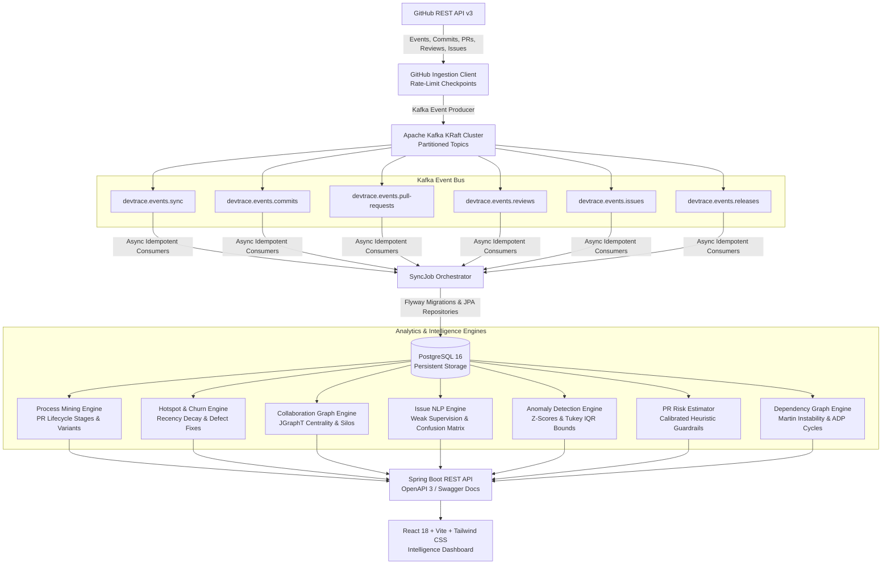

# DevTrace — Software Engineering Intelligence Platform

[](https://github.com/Mithunsurya-Kumarasamy/devtrace/actions/workflows/ci.yml)
[](https://adoptium.net)
[](https://spring.io/projects/spring-boot)
[](https://kafka.apache.org/)
[](https://www.postgresql.org/)
[](https://react.dev/)

DevTrace is a software engineering intelligence platform that connects to GitHub repositories and transforms engineering activity into actionable process mining, codebase hotspot detection, collaboration graphs, issue NLP themes, rolling baseline anomaly detection, and explainable pull request risk guardrails.

---

## 🎯 Product Philosophy & Ethical Guardrails

Traditional developer analytics reduce engineering to vanity metrics like raw commit volume or line counts. **DevTrace is built on the fundamental principle that commit counts do not objectively measure individual developer productivity.** 

Instead, DevTrace focuses on identifying:
- **Process Bottlenecks:** Where pull requests endure prolonged idle wait times for first peer review or final approval.
- **Codebase Hotspots:** Modules exhibiting high churn velocity paired with recurrent defect-fix associations.
- **Architectural Coupling & Blast Radius:** Highly depended-upon packages that undergo frequent changes and circular dependency cycles.
- **Bus Factor & Knowledge Silos:** Critical components authored almost exclusively by a single contributor.
- **Statistical Anomalies:** Spikes and drops in delivery cadence detected using non-parametric rolling baselines and Tukey IQR bounds.
- **Explainable PR Risk:** Heuristic and calibrated probability assessments with actionable guardrail recommendations.

---

## 🏗️ System Architecture



---

## 🔬 Core Intelligence Modules

### 1. Executive Overview & Multi-Pillar Engineering Health
- Aggregates activity metrics (commits, PRs, issues, releases, active contributors) across 30, 90, or 180-day observation windows.
- Calculates transparent multi-pillar **Engineering Health Score (0-100)**:
  - **Code Stability (30%):** Derived from bug-fix rework ratios and commit regularity.
  - **Review Efficiency (30%):** Evaluates median time-to-first-review and approval turnaround.
  - **Release Cadence (20%):** Measures deployment intervals and release predictability.
  - **Collaboration Resilience (20%):** Assesses peer review cross-coverage and absence of single-contributor silos.

### 2. Development Process Mining
- Reconstructs PR event transitions across 3 core lifecycle stages:
  - `CREATION_TO_FIRST_REVIEW`
  - `FIRST_REVIEW_TO_APPROVAL`
  - `APPROVAL_TO_MERGE`
- Computes non-parametric percentiles (Median, P75, P90) to eliminate statistical skew from abandoned PRs.
- Classifies pull requests into 5 empirical **Process Variants**:
  - `FAST_TRACK`: Merged in < 4 hours with minimal review iterations.
  - `STANDARD`: Balanced review turnaround with approval before merge.
  - `REVIEW_HEAVY`: High iteration count with multiple review comments and changes requested.
  - `STALE_REVIEW`: Awaiting initial peer review for > 5 business days.
  - `ABANDONED`: Closed unmerged without recent contributor activity.

### 3. Codebase Churn & Hotspot Scoring
- Correlates file-level additions, deletions, and commit volume with defect-associated commit patterns.
- Applies exponential recency decay weighting ($w = e^{-\lambda \cdot \Delta t}$) to emphasize recent volatility.
- Calculates composite **Hotspot Score (0-100)**:
  $$\text{Score} = \text{Norm}(\text{Churn} \times 0.4 + \text{Commits} \times 0.3 + \text{Defect Fixes} \times 0.3) \times \text{Recency Weight}$$
- Assigns actionable risk tiers (`CRITICAL`, `HIGH`, `MEDIUM`, `LOW`) with refactoring prescriptions.

### 4. Collaboration Network & Knowledge Silos (Bus Factor)
- Constructs weighted undirected developer networks using **JGraphT**.
- Calculates **Degree Centrality** (collaboration volume) and **Betweenness Centrality** (bridge contributors).
- Detects modular communities and evaluates clustering strength via **Newman's Modularity**.
- Flags **Knowledge Silo Warnings** when a single contributor authored $\ge 80\%$ of commits to a critical, frequently-modified component.

### 5. Issue NLP Themes & Weak Supervision
- Categorizes unstructured issue threads across 5 distinct domains:
  - `BUG_DEFECT`
  - `FEATURE_ENHANCEMENT`
  - `DOCUMENTATION`
  - `TECH_DEBT_REFACTOR`
  - `QUESTION_SUPPORT`
- Implements a weak supervision pipeline combining explicit GitHub label ground truth with TF-IDF lexicon keyword matching.
- Generates a full $5 \times 5$ **Confusion Matrix**, overall agreement rate, Precision, Recall, and F1-Scores.
- Tracks resolution duration percentiles per issue category.

### 6. Statistical Anomaly Detection
- Maintains rolling baselines across 4 key delivery metrics:
  - `COMMIT_VOLUME`
  - `PR_SIZE`
  - `REVIEW_TURNAROUND`
  - `CHURN_VOLATILITY`
- Detects statistical anomalies using both parametric **Z-Scores** ($|Z| \ge 2.5$) and robust non-parametric **Tukey IQR Bounds** ($[Q_1 - 1.5 \cdot IQR, Q_3 + 1.5 \cdot IQR]$).
- Persists anomalies to database with severity tiers (`CRITICAL`, `HIGH`, `MEDIUM`, `LOW`) and contextual explanations.

### 7. Pull Request Risk Estimation & Quality Guardrails
- Evaluates individual pull requests using an explainable heuristic model:
  - **Changeset Size Factor (30%):** Penalizes oversized diffs exceeding cognitive review limits (> 500 lines).
  - **Author Experience Factor (25%):** Accounts for historical repository familiarity and commit track record.
  - **Hotspot Exposure Factor (20%):** Flags modifications intersecting high-defect codebase hotspots.
  - **Review Coverage Factor (15%):** Checks for thorough approval sign-offs and conversation depth.
  - **Off-Hours Factor (10%):** Identifies weekend or late-night submissions prone to fatigue defects.
- Generates calibrated risk scores and prescriptive guardrails (e.g., mandatory secondary reviewers, test coverage gates).

### 8. Architectural Coupling & Blast Radius Analysis
- Parses source import statements (Java, TypeScript, Python) to construct an inter-module directed dependency graph.
- Calculates Martin's Metrics:
  - **Afferent Coupling ($C_a$):** Number of incoming dependent modules.
  - **Efferent Coupling ($C_e$):** Number of outgoing module dependencies.
  - **Instability Index ($I$):** $I = \frac{C_e}{C_a + C_e}$ ($0.0 = \text{completely stable}, 1.0 = \text{completely unstable}$).
- Identifies **HIGH_BLAST_RADIUS** components ($C_a \ge 2$ and high churn).
- Uses **Tarjan's Cycle Algorithm** to detect circular dependency loops violating the Acyclic Dependencies Principle (ADP) and provides Dependency Inversion refactoring recommendations.

---

## 📡 API Reference Catalog

All endpoints are documented interactively via OpenAPI / Swagger at `http://localhost:8080/swagger-ui.html`.

| Method | Endpoint | Description |
| :--- | :--- | :--- |
| `GET` | `/api/health` | Diagnostics and core subsystem operational status |
| `POST` | `/api/repositories` | Register new GitHub repository (`owner`, `name`) |
| `GET` | `/api/repositories` | List all connected repositories and sync status |
| `GET` | `/api/repositories/{id}` | Get metadata and status for specific repository |
| `POST` | `/api/repositories/{id}/sync` | Trigger asynchronous Kafka ingestion sync job |
| `GET` | `/api/repositories/{id}/sync-jobs/{jobId}` | Poll real-time progress of sync job checkpoints |
| `GET` | `/api/repositories/{id}/analytics/overview` | Executive summary, volume metrics, health pillars |
| `GET` | `/api/repositories/{id}/analytics/process-mining` | Stage transitions, bottlenecks, process variants |
| `GET` | `/api/repositories/{id}/analytics/churn` | Code churn totals, file additions/deletions |
| `GET` | `/api/repositories/{id}/analytics/hotspots` | Composite hotspot scoring and risk tier rankings |
| `GET` | `/api/repositories/{id}/collaboration-network` | Degree/betweenness centrality and knowledge silos |
| `GET` | `/api/repositories/{id}/analytics/issues-nlp` | Issue classification, confusion matrix, F1-scores |
| `GET` | `/api/repositories/{id}/anomalies` | Rolling baseline metrics, Z-score / IQR outliers |
| `GET` | `/api/repositories/{id}/dependency-graph` | Architectural coupling ($C_a, C_e, I$) and cycles |
| `GET` | `/api/pull-requests/{id}/risk` | Explainable PR risk estimation and guardrails |
| `POST` | `/api/pull-requests/{id}/risk/evaluate` | Force re-evaluation of PR risk factors |

---

## 🚀 Deployment & Local Setup Runbook

### Option 1: Full Docker Compose Deployment (Recommended)

1. **Clone the repository and checkout the working branch:**
   ```bash
   git clone https://github.com/Mithunsurya-Kumarasamy/devtrace.git
   cd devtrace
   git checkout Miskyy
   ```

2. **Configure environment variables:**
   ```bash
   cp .env.example .env
   # Optionally provide your GitHub personal access token in .env:
   # GITHUB_TOKEN=ghp_yourPersonalAccessToken
   ```

3. **Launch all services:**
   ```bash
   docker compose up -d
   ```

4. **Verify running containers:**
   ```bash
   docker compose ps
   ```
   - **PostgreSQL 16:** `localhost:5432`
   - **Kafka KRaft:** `localhost:9092`
   - **DevTrace Backend:** `http://localhost:8080`
   - **DevTrace Frontend Dashboard:** `http://localhost:5173`
   - **Swagger UI:** `http://localhost:8080/swagger-ui.html`

---

### Option 2: Local Development Setup

#### Backend (Spring Boot 3)
```bash
cd backend
# Run test suite
./mvnw test

# Start backend locally (requires Postgres & Kafka running)
./mvnw spring-boot:run
```

#### Frontend (React + Vite)
```bash
cd frontend
# Install dependencies
npm ci

# Run Vite development server
npm run dev
# Build production bundle
npm run build
```

---

## 🌿 Mandatory Git Branching Model

To preserve stability and traceability, DevTrace strictly adheres to this repository branch policy:
- **`master`:** Default, protected production branch. Never receives direct feature development commits.
- **`Miskyy`:** Active development branch. All incremental phase development, tests, and phase commits are integrated and pushed here.

---

## 📋 Completed Phases Breakdown

- [x] **Phase 01:** Establish Project Foundation (Spring Boot 3, React 18, Kafka KRaft, PostgreSQL 16, Docker Compose)
- [x] **Phase 02:** Database and Domain Model (Flyway `V1__initial_schema.sql`, 12 JPA Entities, 11 Spring Data Repositories)
- [x] **Phase 03:** GitHub Integration (Resilient API Client, rate limiting, checkpoint pagination)
- [x] **Phase 04:** Asynchronous Ingestion Pipeline (Kafka event producer, 6 KRaft topics, idempotent upserts)
- [x] **Phase 05:** Core Repository Analytics (Cycle times, review wait times, multi-pillar health score)
- [x] **Phase 06:** Development Process Mining (Stage transitions, bottleneck detection, 5 process variants)
- [x] **Phase 07:** Codebase Hotspot Analytics (Recency decay weighting, defect regex associations, composite score)
- [x] **Phase 08:** Collaboration Graph Analytics (JGraphT network, degree/betweenness centrality, knowledge silos)
- [x] **Phase 09:** Issue NLP Analytics (Weak supervision, 5-class categorization, 5x5 confusion matrix, F1-score)
- [x] **Phase 10:** Anomaly Detection (Rolling baselines across 4 metrics, Z-score & Tukey IQR bounds)
- [x] **Phase 11:** Pull Request Risk Estimation (Explainable factor attribution, calibrated probability, guardrails)
- [x] **Phase 12:** Module Dependency Analysis (Coupling $C_a/C_e$, Martin's Instability, Tarjan cycle detection)
- [x] **Phase 13:** DevTrace Analytics Dashboard (React 18 + Vite + Tailwind glassmorphic dashboard with 11 views)
- [x] **Phase 14:** Harden Integration and Security (Security headers, token masking, log sanitization, validation)
- [x] **Phase 15:** Comprehensive Testing and CI (GitHub Actions CI workflow, end-to-end integration test suite)
- [x] **Phase 16:** Finalize Deployment and Documentation (Production Docker Compose, architecture runbook, API catalog)

---

## 📄 License
DevTrace is open-source software licensed under the Apache 2.0 License.
